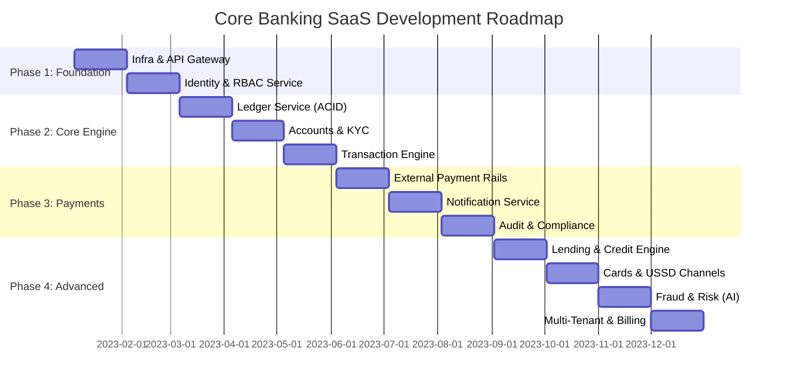

# Product Roadmap: Core Banking SaaS (2023)

## 🗓️ 2023 Vision: From Zero to Core Banking OS

---

## 🎯 Key Milestones

### Q1: The Trust Layer (Jan - Mar)
- **Milestone 1:** Production-ready API Gateway with rate limiting.
- **Milestone 2:** Multi-tenant Auth system with RBAC/ABAC.
- **Milestone 3:** MVP Ledger with double-entry integrity checks.

### Q2: The Banking Core (Apr - Jun)
- **Milestone 4:** Full account lifecycle management (Savings/Current).
- **Milestone 5:** Internal transfer engine with 100% idempotency.
- **Milestone 6:** Real-time balance updates via Event Sourcing.

### Q3: External Ecosystem (Jul - Sep)
- **Milestone 7:** Integration with external payment gateways and banks.
- **Milestone 8:** Event-driven notification system (Email/SMS).
- **Milestone 9:** Automated regulatory reporting (P&L, Balance Sheets).

### Q4: Intelligence & Scale (Oct - Dec)
- **Milestone 10:** Loan origination and repayment automation.
- **Milestone 11:** AI-driven fraud detection and transaction monitoring.
- **Milestone 12:** Full SaaS monetization and per-tenant billing.

---

## 📈 Success Metrics (KPIs)
1. **Consistency:** 0% balance discrepancies in the Ledger.
2. **Reliability:** 99.99% Uptime for API Gateway.
3. **Security:** Zero unauthorized access to critical financial data.
4. **Scale:** Capable of handling 10,000 TPS (Transactions Per Second).
