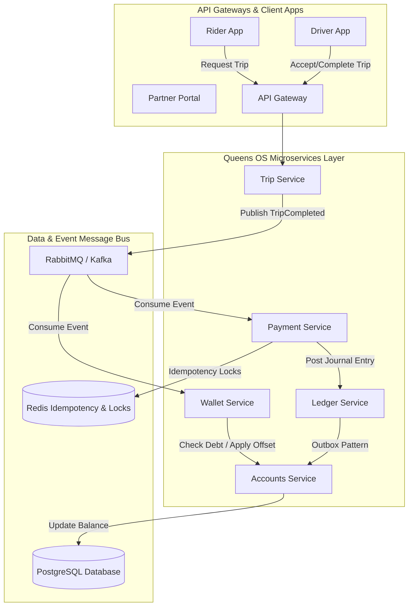
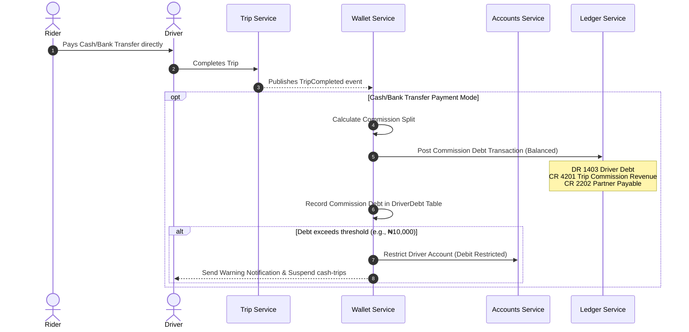
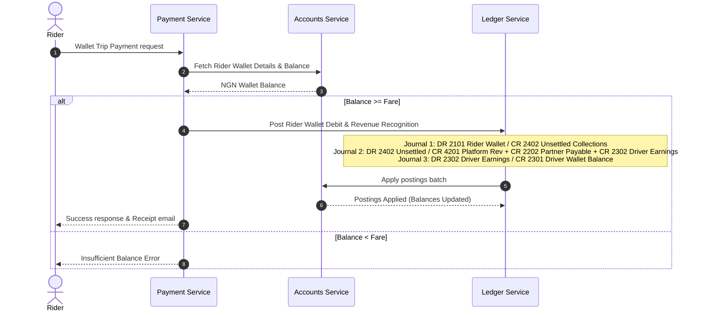

# Queens OS FinTech Accounting & Settlement Architecture Plan

This document details the production-grade architectural design and implementation plan for the **Cash Trip Settlement, Driver Debt, Fleet Partner Revenue, and Double Entry Ledger** system for Queens OS, alongside the completed **Rider Wallet Payment Flow for Trips**.

---

## User Review Required

We are introducing major double-entry rules to keep the ledger balanced.
> [!IMPORTANT]
> - All ledger entries must be balanced (Debits = Credits). Single-sided ledger entry bugs in the legacy `driver-ledger.service.ts` will be resolved.
> - The Rider Wallet trip payment flow will be added as a unified microservice transaction to avoid race conditions.

---

## High-Level Architecture Diagram



---

## Domain Model & Service Boundaries

We strictly isolate core services to protect financial data integrity:
1. **Trip Service**: Handles trip matching, GPS tracking, state transitions, and fare calculation. It does not deal with financial state.
2. **Payment Service**: Integrates with external payment processors (e.g., Paystack, Stripe) and acts as the orchestrator for trip payment verification and split distributions.
3. **Wallet Service**: Manages customer/driver wallet transaction records, auto-settlement, debt restrictions, savings, and partner commission structures.
4. **Accounts Service**: The source of truth for bank account/fiat wallet balances, PND (Post No Debit) and PNC (Post No Credit) restrictions, and KYC limit checks.
5. **Ledger Service**: The core immutable double-entry ledger. All transactions must post balanced journal entries to GL accounts.

---

## Database Schema (PostgreSQL DDL)

To support billions of ledger entries and 10M+ users, we utilize PostgreSQL partitioning on the `ledger_entries` and `journal_entries` tables based on `posting_date` (monthly partitions), combined with indexing strategies.

```sql
-- Partitioned Journal Entries Table
CREATE TABLE journal_entries (
    id UUID NOT NULL DEFAULT gen_random_uuid(),
    reference VARCHAR(100) NOT NULL,
    description VARCHAR(255) NOT NULL,
    posting_date TIMESTAMP WITH TIME ZONE NOT NULL,
    currency VARCHAR(3) NOT NULL DEFAULT 'NGN',
    total_amount NUMERIC(20, 4) NOT NULL,
    tenant_id VARCHAR(50) NOT NULL,
    created_at TIMESTAMP WITH TIME ZONE NOT NULL DEFAULT NOW(),
    PRIMARY KEY (id, posting_date)
) PARTITION BY RANGE (posting_date);

-- Partitioned Ledger Entries Table
CREATE TABLE ledger_entries (
    id UUID NOT NULL DEFAULT gen_random_uuid(),
    journal_entry_id UUID NOT NULL,
    gl_account_id UUID NOT NULL,
    amount NUMERIC(20, 4) NOT NULL,
    side VARCHAR(10) NOT NULL CHECK (side IN ('DEBIT', 'CREDIT')),
    sub_ledger_id VARCHAR(100),
    sub_ledger_type VARCHAR(50) CHECK (sub_ledger_type IN ('CUSTOMER_ACCOUNT', 'DRIVER_ACCOUNT', 'PARTNER_ACCOUNT', 'DRIVER_LEDGER')),
    tenant_id VARCHAR(50) NOT NULL,
    posting_date TIMESTAMP WITH TIME ZONE NOT NULL,
    created_at TIMESTAMP WITH TIME ZONE NOT NULL DEFAULT NOW(),
    PRIMARY KEY (id, posting_date)
) PARTITION BY RANGE (posting_date);

-- Indexes for performance
CREATE INDEX idx_ledger_entries_gl ON ledger_entries(gl_account_id, tenant_id);
CREATE INDEX idx_ledger_entries_subledger ON ledger_entries(sub_ledger_id, sub_ledger_type);
CREATE UNIQUE INDEX idx_journal_ref_tenant ON journal_entries(reference, tenant_id, posting_date);

-- Driver Debt Table (Managed by Wallet Service)
CREATE TABLE driver_debts (
    id UUID PRIMARY KEY DEFAULT gen_random_uuid(),
    tenant_id VARCHAR(50) NOT NULL,
    driver_customer_id VARCHAR(100) NOT NULL,
    total_debt NUMERIC(20, 4) NOT NULL DEFAULT 0.0000,
    outstanding_balance NUMERIC(20, 4) NOT NULL DEFAULT 0.0000,
    total_settled NUMERIC(20, 4) NOT NULL DEFAULT 0.0000,
    debt_threshold NUMERIC(20, 4) NOT NULL DEFAULT 5000.0000,
    status VARCHAR(20) NOT NULL CHECK (status IN ('ACTIVE', 'RESTRICTED', 'SETTLED', 'WAIVED')),
    last_restricted_at TIMESTAMP WITH TIME ZONE,
    restricted_reason VARCHAR(255),
    created_at TIMESTAMP WITH TIME ZONE NOT NULL DEFAULT NOW(),
    updated_at TIMESTAMP WITH TIME ZONE NOT NULL DEFAULT NOW()
);
CREATE UNIQUE INDEX idx_driver_debts_uniq ON driver_debts(tenant_id, driver_customer_id);
```

---

## Double Entry Ledger Design & Chart of Accounts

Every financial event maps to balanced debits (DR) and credits (CR). Asset and Expense accounts increase on DR. Liability, Equity, and Revenue accounts increase on CR.

### 1. Chart of Accounts Setup
- **1101**: Cash at Bank (Asset)
- **1201**: Paystack Clearing (Asset)
- **1403**: Driver Debt / Receivables (Asset)
- **2101**: Customer Wallet (Liability)
- **2202**: Partner Commission Payable (Liability)
- **2301**: Driver Wallet Balance (Liability)
- **2302**: Driver Earnings Payable (Liability)
- **2402**: Unsettled Collections (Liability)
- **4201**: Trip Commission Revenue (Income)

### 2. Transaction Matrices

| Transaction Flow | Account Debited (DR) | Account Credited (CR) | Side-Effects |
| :--- | :--- | :--- | :--- |
| **Rider Wallet Trip Payment** | 2101 Rider Wallet | 2402 Unsettled Collections | Deducts rider's balance |
| **Trip Revenue Allocation (Wallet)** | 2402 Unsettled Collections | 4201 Trip Commission Revenue<br>2202 Partner Payable<br>2302 Driver Payable | splits fare to platform, partner, driver |
| **Driver Earning Credit (Wallet)** | 2302 Driver Payable | 2301 Driver Wallet | Driver receives earnings |
| **Cash Trip Completion (Driver owes commission)** | 1403 Driver Debt (Asset) | 4201 Trip Commission Revenue<br>2202 Partner Payable | Driver gets cash; owes commission |
| **Driver Top-up via Paystack** | 1201 Paystack Clearing | 2301 Driver Wallet | Funds driver's wallet |
| **Auto-Settlement of Cash Debt** | 2301 Driver Wallet | 1403 Driver Debt | Partially or fully pays cash debt |

---

## Open Questions

> [!NOTE]
> 1. Do we want to support automatic credit limit increases for long-standing fleet partners or corporate clients?
> 2. Should we implement micro-currency conversions in real-time or pool exchange transactions daily at EOD?
> *These questions do not block our current implementation but will guide the fine-tuning of the EOD batch engines.*

---

## Proposed Changes

We will introduce and modify several files across `payment-service`, `wallet-service`, and the global ledger system.

### [payment-service]

#### [MODIFY] [trip-payment.controller.ts](file:///Users/test1/Desktop/DemoProjects/Taxi-Hauling/taxibooking-userapp/Core-SAAS-MGT/core-service-backend-crm/apps/payment-service/src/trip-payment.controller.ts)
- Add route `POST /payments/trip/wallet-pay` to handle direct wallet-based trip payments.

#### [MODIFY] [trip-payment.service.ts](file:///Users/test1/Desktop/DemoProjects/Taxi-Hauling/taxibooking-userapp/Core-SAAS-MGT/core-service-backend-crm/apps/payment-service/src/trip-payment.service.ts)
- Implement `walletTripPayment(dto: WalletTripPaymentDto)` that:
  - Fetches the rider's wallet balance from `accounts-service`.
  - Performs balance checks.
  - Generates balanced GL postings for rider wallet debit, revenue allocation, and driver wallet credit.
  - Awards coin rewards.

### [wallet-service]

#### [MODIFY] [driver-ledger.service.ts](file:///Users/test1/Desktop/DemoProjects/Taxi-Hauling/taxibooking-userapp/Core-SAAS-MGT/core-service-backend-crm/apps/wallet-service/src/services/driver-ledger.service.ts)
- Fix the unbalanced single-entry posting bug in `postLedgerEntry` by ensuring it posts a balanced entry (e.g. against platform commission revenue or driver debt accounts).

#### [MODIFY] [wallet-service.service.ts](file:///Users/test1/Desktop/DemoProjects/Taxi-Hauling/taxibooking-userapp/Core-SAAS-MGT/core-service-backend-crm/apps/wallet-service/src/wallet-service.service.ts)
- Integrate automatic debt settlement logic upon wallet funding. When a driver funds their wallet, check for outstanding debts and execute automated settlement/offset entries.

---

## Sequence Diagram: Cash Trip Commission Allocation & Debt Flow



---

## Sequence Diagram: Rider Wallet Trip Payment Flow



---

## API Specifications

### 1. Initiate Wallet-Based Trip Payment
* **Endpoint**: `POST /payments/trip/wallet-pay`
* **Request Body**:
```json
{
  "tripId": "trip-uuid-101",
  "riderCustomerId": "rider-cust-999",
  "fareAmount": 5500.00,
  "currency": "NGN",
  "driverCustomerId": "driver-cust-888",
  "driverType": "CORPORATE",
  "partnerTenantId": "partner-tenant-777",
  "tenantId": "seed-tenant-001"
}
```
* **Response (201 Created)**:
```json
{
  "success": true,
  "message": "Trip wallet payment completed successfully",
  "tripId": "trip-uuid-101",
  "status": "COMPLETED",
  "journalEntries": [
    { "reference": "WLT-PAY-trip-uuid-101", "id": "journal-uuid-999" }
  ]
}
```

---

## Edge Cases & Mitigation Strategies

1. **Rider Wallet Balance race conditions**: Managed via Redis locks on `wallet:lock:${riderCustomerId}` during transaction execution.
2. **Postings apply timeout/failure**: The Ledger Service uses SQL Transactions (`SERIALIZABLE` isolation level). If the `accounts-service/postings/apply-batch` HTTP request fails or times out, the ledger SQL transaction rolls back fully.
3. **Overpayment of Debt**: If a driver settles more than their outstanding debt, the excess amount remains in their wallet balance (fiat wallet liability) and is not deducted.

---

## Verification Plan

### Automated Tests
We will execute unit and integration tests to verify correct ledger entry validation and balance logic.
```bash
# Run ledger service tests
npm run test apps/ledger-service

# Run payment service integration tests
npm run test apps/payment-service
```

### Manual Verification
1. Call `POST /payments/trip/wallet-pay` to simulate a complete wallet trip payment.
2. Verify that Rider Wallet balance is decremented and Driver Wallet balance is incremented.
3. Verify via `GET /ledger/posting/reference/WLT-PAY-...` that all double-entry lines balance perfectly.
4. Call `POST /wallet/payments/cash` to record a cash trip. Verify that Driver Debt outstanding balance is incremented, and if it exceeds threshold, status becomes `RESTRICTED`.
5. Call `POST /wallet/funding` for the driver. Verify that auto-settlement immediately triggers and reduces the outstanding debt.
