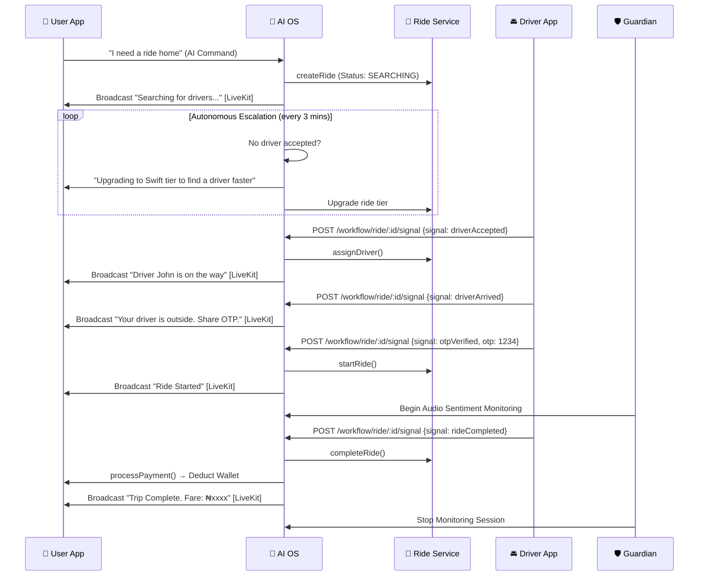

# 🚗 Full AI Ownership: Ride-Hauling End-to-End Flow

This document defines the complete, production-ready lifecycle of a ride, fully orchestrated by the **Sentinel-X AI Operating System**. Every state transition requires a real signal from a real actor (User, Driver, or OS). No `sleep()` timers. No simulation.

---

## 🎬 Complete Trip Sequence



---

## 📡 Signal API Reference

All signals are sent by the **Driver App** to the **AI OS** via this endpoint:

```
POST /api/v1/os/workflow/ride/:workflowId/signal
```

### Signal Payloads

| Signal | Sent by | Payload |
|---|---|---|
| `driverAccepted` | Driver App | `{ driverId, driverName, vehiclePlate, eta }` |
| `driverArrived` | Driver App | `{ driverId }` |
| `otpVerified` | Driver App (after user provides code) | `{ otp: string }` |
| `rideStarted` | Driver App | `{ driverId }` |
| `rideCompleted` | Driver App | `{ driverId, distance, duration }` |
| `rideCancelled` | User or Driver App | `{ reason: string }` |

---

## 🧠 AI Autonomous Behaviors

| Trigger | AI OS Action |
|---|---|
| No driver in 3 minutes | Upgrade ride tier and re-broadcast |
| CRITICAL audio distress detected | Guardian triggers police relay + user intervention |
| Route deviation > 500m | Sentinel flags SAFETY_ALERT, broadcasts to driver room |
| Heavy rain + rush hour | Oracle broadcasts TACTICAL_NAV voice alert |
| Ride completed | AI deducts wallet, sends receipt, rates the trip |

---

## 🔐 OTP Verification Flow

1. OS generates a 4-digit OTP when `driverArrived` signal is received.
2. OS broadcasts OTP to the **User's** LiveKit room (shown in-app).
3. User reads OTP to driver verbally.
4. Driver enters OTP in their app which sends `otpVerified` signal.
5. OS validates OTP match — only then does the ride transition to `STARTED`.

---

## 💰 Autonomous Payment Deduction

Upon `rideCompleted` signal:
1. OS calls `completeRide()` activity to get the final fare.
2. OS calls `processRidePayment()` to deduct from user wallet or charge card.
3. OS broadcasts a receipt to the User's LiveKit room.
4. OS publishes `RIDE_COMPLETED` event to the message bus for analytics.
